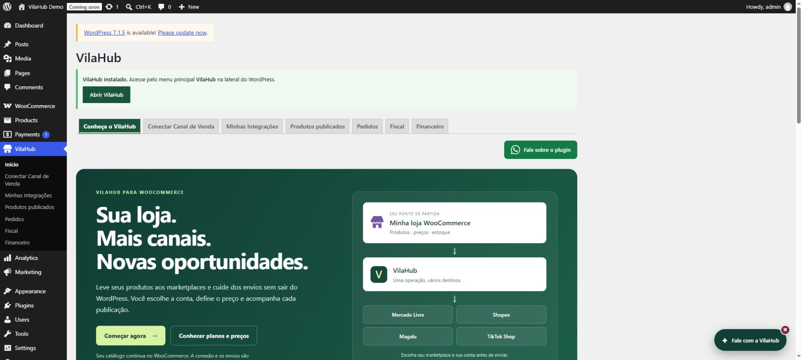
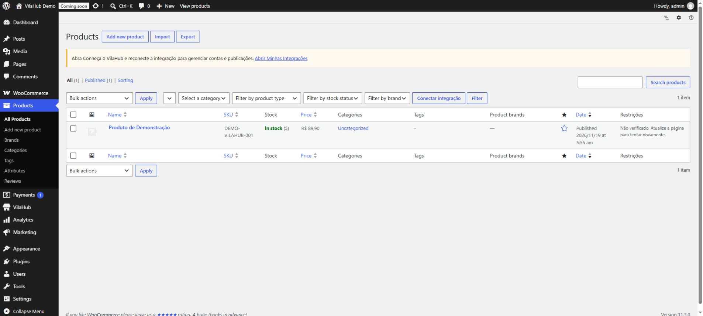
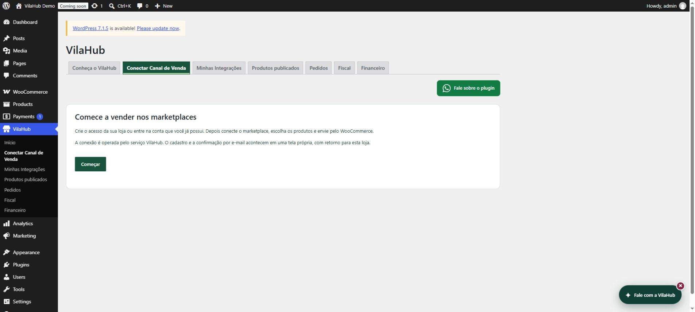
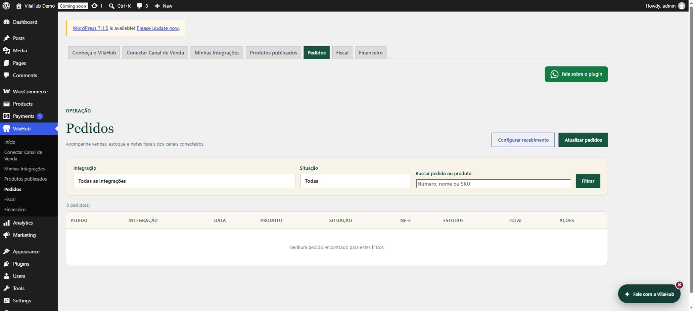

# Integração WooCommerce: Mercado Livre, Shopee e Magalu – VilaHub


Plugin oficial de código aberto para conectar uma loja WooCommerce ao serviço de integração VilaHub.

[Instalar pelo WordPress.org](https://wordpress.org/plugins/vilahub-for-woocommerce/) · [Pacote no WPackagist](https://wpackagist.org/search?q=vilahub-for-woocommerce) · [VilaHub](https://vilahub.com.br) · [Suporte](https://wordpress.org/support/plugin/vilahub-for-woocommerce/)

[Página pública do plugin](https://vilabrasilmarketplace.github.io/vilahub-for-woocommerce/)

[Testar no WordPress Playground](https://playground.wordpress.net/?blueprint-url=https%3A%2F%2Fvilabrasilmarketplace.github.io%2Fvilahub-for-woocommerce%2Fblueprint.json%3Fv%3D20261120)

[Kit de imprensa e parcerias](https://github.com/vilabrasilmarketplace/vilahub-for-woocommerce/releases/download/v1.0.3/VilaHub-WooCommerce-Press-Kit-1.0.3.zip)

[Suporte](SUPPORT.md) · [Política de segurança](SECURITY.md) · [Changelog](CHANGELOG.md) · [Verificação da versão](VERIFICATION.md)

## O que o plugin faz

O WooCommerce continua sendo a loja e pode ser a origem do catálogo. O plugin adiciona o fluxo de autorização e operação de marketplaces:

- autorização da loja com OAuth e PKCE;
- seleção explícita da conta de marketplace;
- envio de produtos e variações com revisão;
- atualização de preço e estoque quando suportada pelo canal;
- acompanhamento de resultados e correções de publicação;
- tela separada para pedidos de marketplaces;
- escolha entre WooCommerce e ERP externo como autoridade de estoque;
- compatibilidade com HPOS e armazenamento legado.

Cada instalação fica vinculada à empresa, às credenciais e à URL da loja autorizadas.

## Requisitos

- WordPress 6.5 ou superior;
- WooCommerce 9.0 ou superior;
- PHP 8.1 ou superior;
- OpenSSL;
- HTTPS;
- conta VilaHub.

## Instalação

Instale pelo diretório oficial:

https://wordpress.org/plugins/vilahub-for-woocommerce/

Depois da ativação:

1. Abra `VilaHub > Início`.
2. Autorize a loja no serviço VilaHub.
3. Conecte uma conta de marketplace compatível.
4. Revise um produto controlado antes de ampliar a sincronização.

Não ative uma segunda cópia em outra pasta de plugin na mesma loja.

## Primeiro teste em 15 minutos

Use uma loja de homologação e mantenha a sincronização automática desligada:

1. Confirme WordPress 6.5+, WooCommerce 9.0+, PHP 8.1+, HTTPS e faça backup.
2. Instale e ative o plugin oficial.
3. Abra `VilaHub > Início` e autorize a loja.
4. Prepare um produto controlado com SKU exclusivo, estoque 5, preço conhecido e uma imagem.
5. Escolha uma conta de teste, confirme um único envio e registre o resultado e o ID do anúncio.
6. Atualize preço e estoque, sincronize duas vezes e confirme que a atualização não foi duplicada.

O guia completo está em https://vilahub.com.br/ajuda/plugin-woocommerce-instalacao.

## Instalação por Composer

Para projetos WordPress gerenciados com Composer e WPackagist:

```bash
composer config repositories.wpackagist composer https://wpackagist.org
composer require composer/installers
composer require wpackagist-plugin/vilahub-for-woocommerce:^1.0
```

O WPackagist espelha a versão estável publicada no WordPress.org.

## Veja o plugin

### Tela inicial



### Produtos e destino de envio



### Conexão de canais



### Pedidos de marketplaces



## Limites importantes

- Os recursos dependem do provedor, da conta e do plano.
- O marketplace toma a decisão final sobre uma publicação.
- Operações fiscais e de expedição exigem suporte do canal, configuração e confirmação do usuário.
- Pedidos nativos do WooCommerce não são enviados pela integração de pedidos de marketplaces.
- A recepção de pedidos não emite nota fiscal nem baixa estoque automaticamente sem a configuração e a confirmação aplicáveis.

## Código e versões

Versão estável atual: **1.0.7**.

- WordPress.org SVN: https://plugins.svn.wordpress.org/vilahub-for-woocommerce/
- WPackagist: https://wpackagist.org/search?q=vilahub-for-woocommerce
- Releases do GitHub: https://github.com/vilabrasilmarketplace/vilahub-for-woocommerce/releases
- Projeto de tradução: https://translate.wordpress.org/projects/wp-plugins/vilahub-for-woocommerce/
- Documentação da API: https://vilahub.com.br/api/v1/docs

## Licença

GPL-2.0-or-later.

